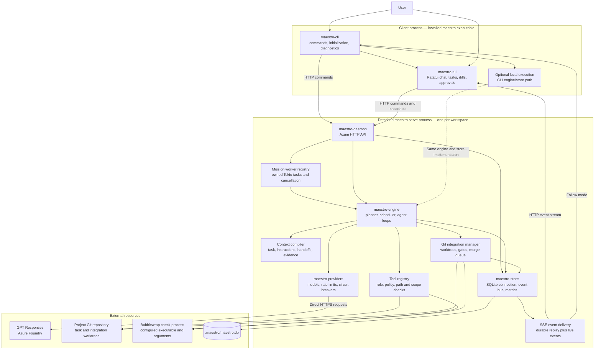
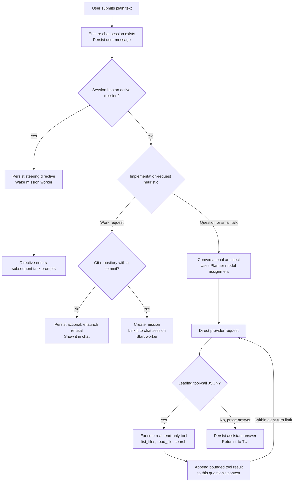
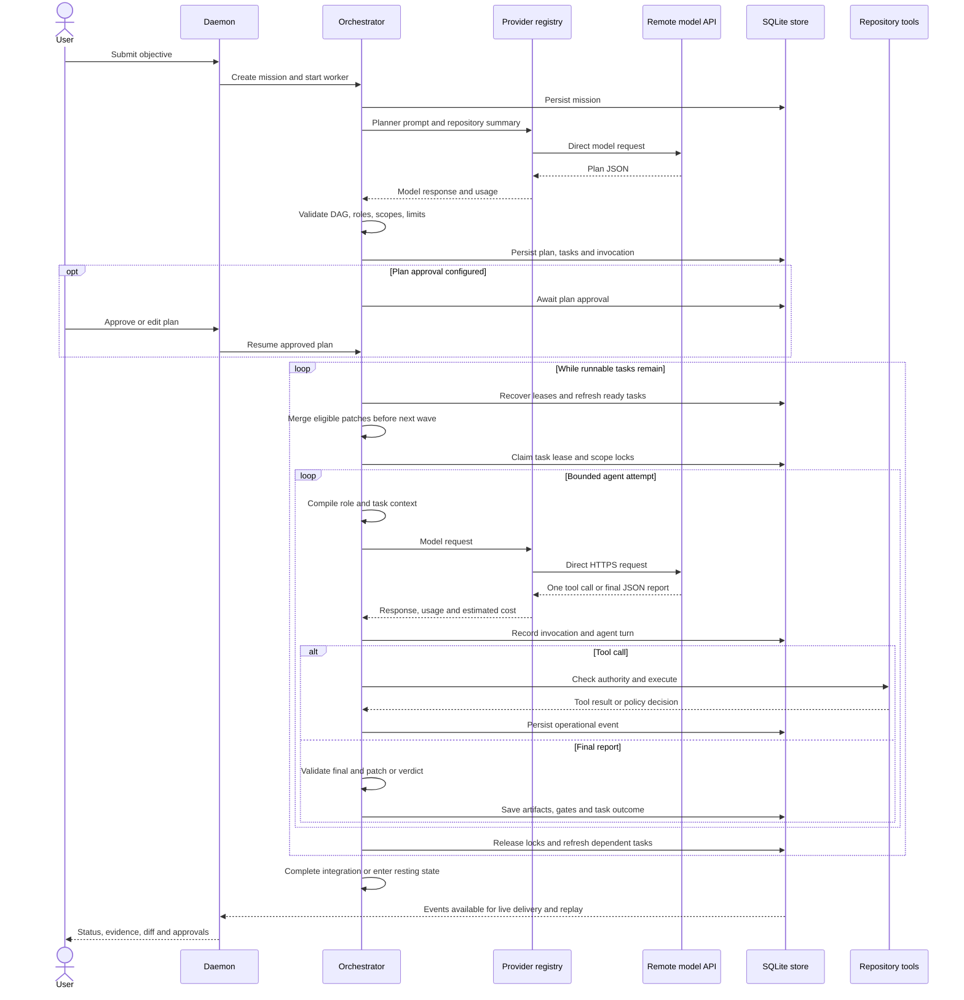
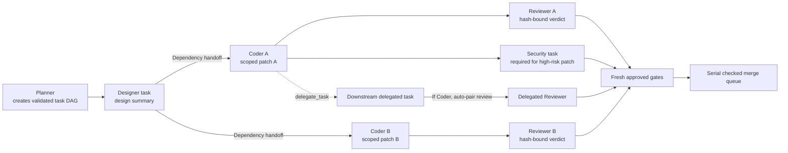
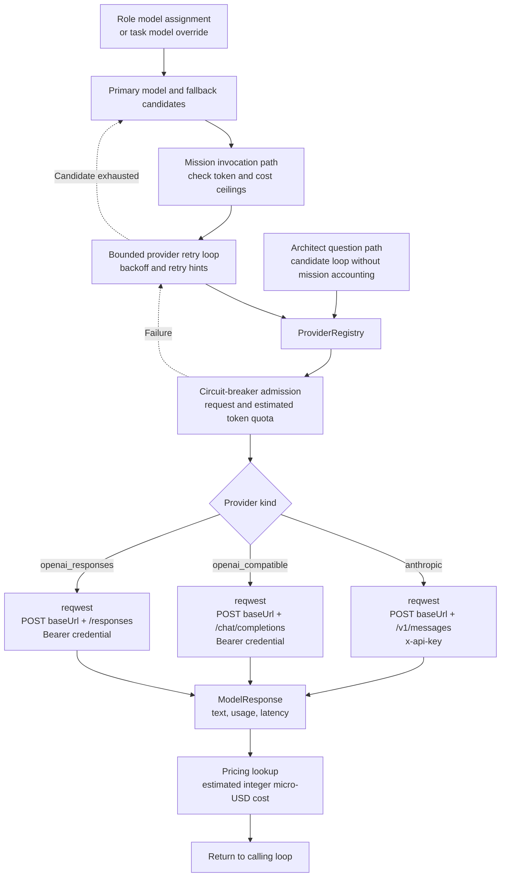
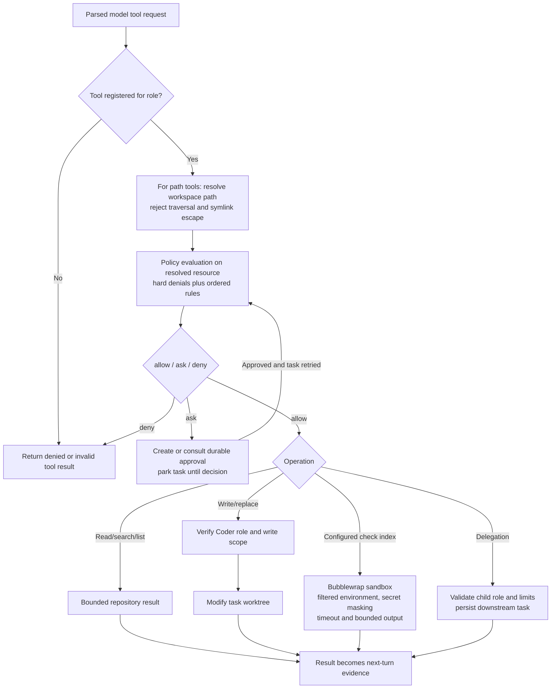
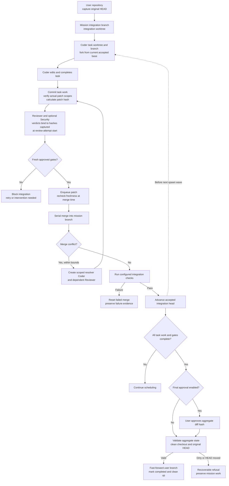
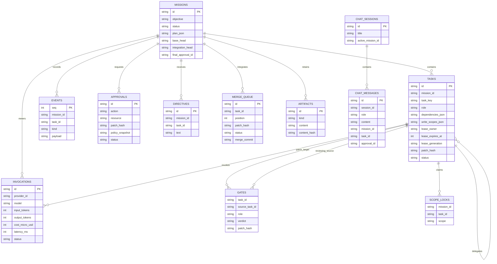
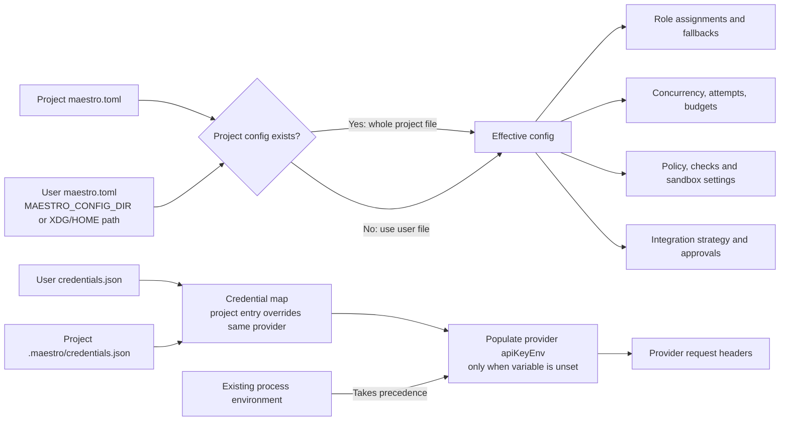
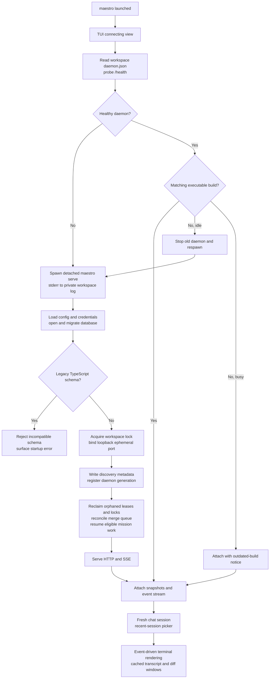

# Maestro — current Rust architecture

> **Runtime update:** the installed working-agent loop now uses LangChain native
> tool calls and LangGraph checkpoints. See [LangGraph execution](langgraph.md)
> for the current boundary and snapshot behavior. The custom Rust turn protocol
> described below remains the `native` compatibility backend; planning and
> architect chat still use Rust.


The current presentation client and four-agent role mapping are documented in
[the website integration guide](../../21-Caffeine-/docs/DAEMON_INTEGRATION.md).
Enable `[runtime] guildRoles = true` for Shogun/Samurai/Sentinel/Shadow contracts and both independent gates.

Source snapshot: **2026-10-29**, including the current uncommitted fixes.
Implementation: `/home/anay/Desktop/Projects/maestro-rs`, Rust package version
`0.1.0`. The sibling `Maestro/` directory is the older TypeScript prototype.

Maestro is its own agent runtime. It calls provider APIs directly, builds model
context, executes tools, schedules tasks, and manages Git integration. It does
not execute Claude Code, Codex CLI, or OpenCode to do the work. Their local
configuration was used as a source of provider settings and credentials.

## 1. Whole-system view



The dotted local path represents an alternative execution mode in the CLI
process; it does not call a daemon-resident engine. Agent workers are async
tasks, not independent Claude/Codex processes. Git and configured checks do
spawn operating-system processes.

## 2. Chat routing and the architect



Slash commands provide explicit actions; the diagram shows ordinary chat text.
The heuristic strips common courtesy prefixes, keeps informational questions
and small talk conversational, and otherwise defaults to work. It is not a
model-based intent classifier.

The architect has its own smaller tool loop and protocol:

```json
{"tool":"read_file","args":{"path":"README.md"}}
```

It uses read-only enforcement even though it calls the Planner's model.
Saved sessions replay in the UI, but earlier saved chat turns are **not currently
loaded into `answer_question`**. Each question starts a new model context with
its own tool results. Architect calls also bypass mission invocation accounting
and mission token/cost budgets.

## 3. Mission planning and agent execution



Plans contain 1–12 tasks with dependencies pointing to earlier tasks. Runtime
delegation can expand the graph subject to configured depth and task-count caps.
Task attempts use leases, heartbeat renewal, guarded outcome writes, and scope
locks. Independent ready tasks can run concurrently when configuration permits.

Mission agents use Maestro's JSON-in-text protocol, not provider-native tool
execution:

```json
{"kind":"tool","tool":"read_file","arguments":{"path":"src/main.rs"}}
```

The model proposes the tool call. Maestro validates and executes it. A final
report contains `status`, `summary`, `evidence`, and `risks`; Reviewer/Security
also supply a verdict and reasons.

## 4. How the five roles collaborate

This is an example valid graph, not a fixed pipeline used by every mission.



| Role/path | Tools currently registered |
| --- | --- |
| Mission Planner | No repository tools; receives supplied context and produces plan JSON |
| Designer | `list_files`, `read_file`, `search`, `delegate_task` |
| Coder | Read/search tools, `write_file`, `replace_text`, `run_check`, `delegate_task` |
| Reviewer / Security | Read/search tools, `run_check`, `delegate_task`; no writes |
| Conversational architect | `list_files`, `read_file`, `search` only |

Communication uses task contracts, completed dependency summaries, accepted
code, delegation, and verdict records. Dependency handoffs include the latest
model final report, runtime patch provenance (hash, base, changed paths and
scope verification), and the first and most recent runtime check receipts.
Each receipt has an artifact ID and check receipts include the actual command,
workspace, exit status and bounded output. Model-authored claims are labeled
separately from runtime receipts. Full agent conversations are not shared. A delegated task depends on its parent completing.

There is no free-form inter-agent chat bus and no automatic general-purpose
`changes_requested → original coder revision → re-review` loop. A failed gate
blocks integration. Conflict resolution during merging has its own bounded
Coder/Reviewer task creation mechanism.

## 5. Provider transport and reliability



All network transports implement `generate` and `stream`. The current mission
and architect loops call **`generate`**, so their model responses are consumed
whole. The daemon's **SSE mission event stream is a different channel** from
provider token streaming.

GPT uses Responses (`input`, `max_output_tokens`, `text.format`, `store: false`);
the optional Chat Completions transport supports `messages`, `max_tokens`, and
`response_format`, but no active deployment uses it.
Incomplete, failed, or empty Responses outputs are errors; only assistant text
enters the agent protocol. No Claude/Codex/OpenCode CLI adapter is involved.
Production excludes the mock transport; test dependencies explicitly enable it.

All seven deployed GPT variants are configured. Kimi and other low-quota models
are excluded from active providers, roles, fallbacks, and the picker.
Pinned deployment IDs prevent Azure's global model catalog from populating the
picker with unavailable models. Per-deployment request buckets and rolling token
reservations guard both generate and stream calls. Token reservations estimate
input as UTF-8 bytes / 3 plus message overhead and reserve the output cap for
60 seconds. This is an estimate; Azure's 429/Retry-After remains authoritative.
Unknown pricing entries can record zero estimated cost, so dollar budgets are
only as accurate as the pricing catalog. Provider cancellation uses propagated
cancellation tokens.

## 6. Tool authority and check isolation



Reviewer/Security writes and external-directory access are hard-denied. Secret
file matching covers `.env` and `.env.*`, with `.env.example` explicitly allowed;
this is not a universal detector for every possible secret-bearing file.

Checks use configured executable/argument arrays, not arbitrary shell strings
chosen by the model. Bubblewrap is Linux-specific and controls check processes.
It does not contain the daemon's own provider HTTPS traffic. Required sandbox
mode fails closed; other configured modes have different guarantees.

## 7. Git worktrees, review gates, and final integration



This shows the normal `mission-branch` strategy. A configurable `direct`
integration strategy also exists and has different behavior. Missions with no
patch can complete without final integration.

Retried Coder worktrees are refreshed when their saved fork point no longer
matches the accepted integration head. Failed missions preserve their mission
branch; explicit cancellation can delete it. Paused/blocked missions retain
workspaces for recovery. There is currently no mission-rebase command when the
user's HEAD changes during a mission.

## 8. Persistent data model

Logical relationships below describe runtime associations; not every edge is
implemented as a SQL foreign-key constraint. Optional task/mission links are
used for chat and mission-level invocations.



Additional tables track daemon generations and provider health. SQLite uses WAL,
versioned `PRAGMA user_version` migrations, prepared statements, and a shared
connection protected by a mutex. In-memory broadcast events support live
subscribers; persisted sequence numbers support replay after reconnect. Metrics
record store-operation latencies, and the daemon exposes metrics and RSS.

## 9. Configuration and credential resolution



Project config replaces the user config **wholly**, rather than merging each
field. Credentials use per-provider overlays. Saved keys are separate from
model configuration and use `0600` files. Production's starter config uses GPT
and requires a key. The installed global config uses the current Foundry
resource key, retrieved through the authenticated Azure CLI because the inherited
Codex key was stale.

Current global assignments, updated on 2026-10-30:

| Role | Model | Fallback |
| --- | --- | --- |
| Planner | `foundry-astra/gpt-6-astra` | GPT 6.1 Sol, GPT 6 Sol |
| Designer | `foundry-sol/gpt-6-sol` | GPT 6.1 Sol, GPT 5.6 Terra |
| Coder | `foundry-gpt/gpt-6.1-sol` | GPT 6 Sol, GPT 5.6 Sol |
| Reviewer | `foundry-gpt/gpt-6.1-sol` | GPT 6 Sol, Astra |
| Security | `foundry-astra/gpt-6-astra` | GPT 6.1 Sol |

Every enabled deployment: 1,000 RPM / 1,000,000 TPM.
All roles use 48,000 context characters / 8,192 output tokens.
These are Maestro operating budgets, not claimed model context
maximums. Azure's model metadata did not report context maxima.
Global concurrency is two tasks, with two million mission tokens and final
approval enabled. The estimated-cost ceiling is $20, using reference rates
of $10/$50 per million input/output tokens for Astra, $2/$10 for GPT 6.1 Sol
and GPT 6 Sol.
These estimates exclude Azure-specific billing adjustments and cache accounting.
Astra reasoning effort is `medium`; other GPT deployments use `low`. Global `checks` is empty;
checks must be supplied by each project. See [Foundry setup and verification](foundry-gpt-kimi.md).

## 10. Startup, recovery, and the terminal UI



The Rust daemon defaults to **`127.0.0.1:0`**: the operating system chooses an
available port, published in `.maestro/daemon.json`. A token is required to bind
off-loopback; configured tokens protect `/api` routes even on loopback.

The UI has Chat, Tasks, Diff, Approvals, and Events views; slash suggestions;
model/role and session pickers; cached markdown rendering; and a responsive
team sidebar. Repainting uses a dirty flag and an approximately 33-ms frame
budget. Animation ticks run when activity requires them. This frame budget is
separate from the historical sub-10-ms target for local control operations.

Quitting the UI does not stop the detached daemon. Daemon shutdown cancels and
joins mission workers with a bounded worker grace period. A hard bound on the
entire HTTP graceful-shutdown drain remains a known follow-up.

## 11. Files and source entry points

```text
~/.local/bin/maestro                 Installed standalone Rust executable
~/.config/maestro/
  maestro.toml                      User-level model/runtime configuration
  credentials.json                  User-level provider credentials

<project>/
  maestro.toml                      Optional whole-project override
  .maestro/
    maestro.db                      Rust SQLite state
    daemon.json                     Bound URL, PID and generation
    daemon.lock/                    Exclusive workspace lock
    daemon.stderr.log               Detached startup/runtime stderr
    credentials.json                Optional credential overrides
    instructions.md                 Optional project instructions
    worktrees/                      Isolated task checkouts
    integration/                    Mission integration checkouts
```

| Concern | Source |
| --- | --- |
| Shared contracts | [maestro-types/src](../crates/maestro-types/src) |
| CLI dispatch and launch | [lib.rs](../crates/maestro-cli/src/lib.rs), [context.rs](../crates/maestro-cli/src/context.rs) |
| TUI event loop | [app.rs](../crates/maestro-tui/src/app.rs) |
| HTTP routing and chat | [http.rs](../crates/maestro-daemon/src/http.rs) |
| Owned mission workers | [workers.rs](../crates/maestro-daemon/src/workers.rs) |
| Planning and agent loops | [orchestrator.rs](../crates/maestro-engine/src/orchestrator.rs) |
| Prompts and context | [prompts.rs](../crates/maestro-engine/src/prompts.rs), [context.rs](../crates/maestro-engine/src/context.rs) |
| Tools, policy and sandbox | [tools.rs](../crates/maestro-engine/src/tools.rs), [policy.rs](../crates/maestro-engine/src/policy.rs), [sandbox.rs](../crates/maestro-engine/src/sandbox.rs) |
| Worktrees and integration | [worktrees.rs](../crates/maestro-engine/src/worktrees.rs), [integration.rs](../crates/maestro-engine/src/integration.rs) |
| Provider transport | [registry.rs](../crates/maestro-providers/src/registry.rs), [anthropic.rs](../crates/maestro-providers/src/anthropic.rs), [openai_compatible.rs](../crates/maestro-providers/src/openai_compatible.rs) |
| Database schema and migrations | [migrations.rs](../crates/maestro-store/src/migrations.rs) |

## 12. Current boundaries

- No Claude Code, Codex CLI, or OpenCode adapter.
- No MCP client/plugin runtime, semantic/LSP context retrieval, or cross-repo
  parent-folder mission orchestration.
- No general automatic failed-review correction loop or free-form agent chat.
- Saved chat history is visible in the UI but is not full model conversation
  memory. Architect calls are outside mission accounting.
- Provider streaming exists as a transport capability; the current agent loops
  do not consume it.
- No mission-rebase command for a changed user HEAD.
- Foundry authentication is repaired; GPT and Kimi have both answered live requests.

Historical implementation and benchmark evidence:
[REPORT-2026-08-28.md](REPORT-2026-08-28.md). UI design intent:
[UI-BRIEF.md](UI-BRIEF.md). Those older documents may describe intended behavior
or an earlier snapshot; this document follows the current source paths.


## Inspection routing and blocked-run visibility (2026-10-29)

Requests such as “look into the repo and explain it” and “go through the project”
use read-only architect chat. An explicit follow-up action, such as “and fix the
login bug,” still launches an implementation mission. Standalone Reviewer and
Security tasks with no dependencies can inspect the repository directly; tasks
with declared dependencies still require those dependency workspaces.

The TUI fetches role/model assignments when connecting and keeps that roster
visible while idle. Blocked and paused mission states are announced in the
transcript, task failures include their reason, and blocked snapshots retain a
visible explanation when resumed. Informational chat detaches from a stopped
mission while preserving its history.

Verified against the reported Family-Tree request: the exact wording returned an
architect explanation in 41.1 seconds, kept the mission count at one (the original
failed run), and cleared the chat's active-mission association. The existing
working-tree diff and Git status were unchanged. Routing, daemon, engine and TUI
checks passed: 230 relevant tests.

Follow-up: conversational prefixes are stripped repeatedly, so “Now explain me
the tech stack of this project” and “Can you now explain…” also stay in architect
chat. The former wording previously launched a Kimi review mission whose tool
loop repeatedly waited for its 20,000-token-per-minute quota. The corrected live
request returned an explanation in 32.1 seconds, created no mission, and preserved
the application working tree. Engine and daemon checks passed: 132 tests.


## Task recovery and transcript navigation (2026-10-30)

Working agents judge completion against their own task, rather than the whole
mission objective. Designers deliver a design handoff; inability to edit or
launch the server is expected for that role. Before accepting a blocked report,
the runtime gives one task-scope clarification within the existing turn budget.
A repeated genuine block is honored. Final blocked/failed reports persist their
reasons (falling back to the summary) in task state and events. Legacy reports
can display their summary when no reason was stored.

Up to two malformed protocol replies can be corrected within the same attempt,
retaining gathered tool evidence instead of restarting inspection. This does not
execute malformed calls or mark incomplete tasks successful.

The transcript clamps scrolling to the first full viewport, including after
resize or tool-output collapse. User messages have a full-width highlight; the
current request stays at the top while following, and the relevant earlier
request is pinned while reading history. Sidebar task titles wrap. Press `2`,
select a task, and press Enter for full task details; arrows/j/k, mouse wheel,
and Page Up/Down scroll descriptions, reasons, acceptance criteria, and summaries.

The reported Family-Tree Designer task was replayed with real GPT calls in a
separate evidence store. The first replay identified absent dependencies and
Next.js guides. After `npm ci`, the same task completed in 108 seconds and
produced a concrete design handoff. Existing Git status and tracked diff were
preserved. This verified the design stage; it did not run the redesign or launch
stages of the original mission. See
[replay evidence](evidence/designer-recovery-2026-10-30.json).

Validation: 236 engine, daemon, and TUI tests passed. An actual PTY session
verified top-of-history scrolling, a highlighted pinned latest request, wrapped
sidebar titles, and task-detail navigation. The release binary was installed and
both idle user daemons restarted with the updated engine.

## Visual inputs and local validation

The current engine also supports durable image attachments, workspace image viewing, Playwright inspection of localhost pages, managed Next.js/Vite previews, ranged reads and per-file diffs. Image payloads are hydrated at invocation time; checkpoints retain references. See [visual tools](visual-tools.md) for the detailed Mermaid flow and execution limits.
