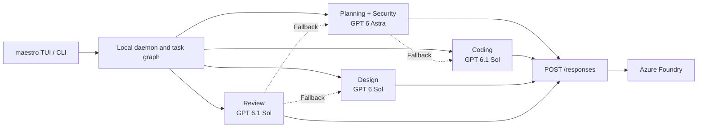

# Maestro: GPT on Azure Foundry

Updated 2026-10-30. Active source: `maestro-rs`; installed executable:
`~/.local/bin/maestro`. The sibling `Maestro` repository is the older TypeScript
prototype. See [the full architecture](architecture.md) for all subsystems.

Working agents now use the [LangGraph runtime](langgraph.md), with the same fixed
role assignments and configured failure fallbacks.

## Live configuration

Maestro calls Azure directly. Codex, Claude Code and OpenCode are not subprocess
backends. The local Codex config identified the endpoint; its inherited key was
stale. The authenticated Azure CLI returned the current resource key. Argmin's
`apps/azure-control/backend/azure_client.py` established how to inspect model
capabilities and deployment quotas through Azure's management API. No Azure
resource or quota allocation was changed.

Endpoint: `https://anaysumeet-4414-resource.openai.azure.com/openai/v1`

| Role | Primary | Fallback | Context budget | Output cap |
| --- | --- | --- | ---: | ---: |
| Planner | GPT 6 Astra | GPT 6.1 Sol, GPT 6 Sol | 48,000 characters | 8,192 tokens |
| Coder | GPT 6.1 Sol | GPT 6 Sol, GPT 5.6 Sol | 48,000 characters | 8,192 tokens |
| Designer | GPT 6 Sol | GPT 6.1 Sol, GPT 5.6 Terra | 48,000 characters | 8,192 tokens |
| Reviewer | GPT 6.1 Sol | GPT 6 Sol, Astra | 48,000 characters | 8,192 tokens |
| Security | GPT 6 Astra | GPT 6.1 Sol | 48,000 characters | 8,192 tokens |

These are Maestro operating budgets. The GPT model page documents a 1,050,000
token context window and 128,000 maximum output tokens; Azure deployment
metadata did not independently report context maxima. GPT reasoning effort is
`medium` for Astra and `low` for the other GPT deployments.

Only the seven GPT deployments are enabled. Kimi and other low-quota deployments
are excluded from role assignments, fallbacks, and the picker. Every enabled
deployment has an allocated 1,000,000 TPM and 1,000 RPM.



## Actual allocated limits

Read from the current deployment `properties.rateLimits` through management
API version `2025-06-01`. GPT/Kimi data-plane response headers confirmed the
same limits. The allocation is shared with other clients of each deployment.

| Deployment | Requests per minute | Tokens per minute | Used by Maestro |
| --- | ---: | ---: | --- |
| `gpt-6.1-sol` | 1,000 | 1,000,000 | Primary GPT |
| `gpt-6-sol`, `gpt-6-astra`, `gpt-6-luna` | 1,000 each | 1,000,000 each | Active Sol/Astra; Luna selectable |
| `gpt-5.6-sol`, `gpt-5.6-luna`, `gpt-5.6-terra` | 1,000 each | 1,000,000 each | Selectable; Sol/Terra fallbacks |
| `Kimi-K2.7-Code` | 20 | 20,000 | No |
| `Kimi-K2.6`, `Kimi-K2.5` | 20 each | 20,000 each | No |
| `DeepSeek-V4-Pro` | 20 | 20,000 | No |
| `grok-4.6` | 50 | 50,000 | No |

Each provider ID is pinned to one deployment. Azure `/models` returned 473
catalog entries, so using it unfiltered would advertise unavailable models.
The picker shows all configured deployment names as configured entries;
configuration alone is not represented as successful live model discovery.

Request buckets and a rolling 60-second token reservation guard calls.
Reservations estimate input using UTF-8 bytes / 3 plus message overhead and
reserve the configured output cap. Requests larger than the entire minute's
budget fail promptly, allowing a configured fallback. Waiting is cancellable.
Azure's 429 and Retry-After responses remain authoritative; estimates are not
exact tokenization, and limiters are local to each daemon.

## Files and defaults

- Configuration: `~/.config/maestro/maestro.toml`.
- Private credentials: `~/.config/maestro/credentials.json`, mode `0600`.
- All providers use `MAESTRO_FOUNDRY_API_KEY`, populated from that credential
  store when not already present in the process environment.
- Previous configuration and credentials have timestamped private backups.
- Reusable configuration: [examples/foundry.toml](../examples/foundry.toml).
- Normal release builds exclude the mock transport and reject `kind = "mock"`.
  Deterministic fixture models exist only for explicitly enabled test builds.
- A project `maestro.toml` overrides the global file entirely. Global checks
  are empty because check commands belong to the target project.

The global runtime allows two simultaneous tasks, two million mission tokens,
and a $20 estimated-cost ceiling. Final integration approval stays enabled for
normal projects. Only the disposable smoke repository disables it.

Reference prices per million input/output tokens include Astra $10/$50 and GPT
6.1 Sol and GPT 6 Sol $2/$10. GPT rates come from official model pages. These
are runtime estimates, not verified Azure invoice rates; cache writes, cache
hits and provider-specific adjustments are not reconciled by this price table.

## Historical verification (2026-10-29)

These runs used the previous GPT/Kimi lineup; their evidence is preserved. The
current GPT-only configuration is shown above.

After the Astra update, all **10 deployed GPT/Kimi models** passed live requests
using their configured API transport and JSON output format. At that time, Astra handled
planning and security; Sol 6.1 coded, Sol 6 designed, and Kimi 2.7 reviewed.
The picker also exposed GPT 6 Luna, GPT 5.6 Sol/Terra/Luna and Kimi 2.6/2.5.
Astra also produced a valid two-task plan through the installed Maestro daemon
(372 input / 509 output tokens), correctly stopped for plan approval, and was
then cancelled as a disposable planning check. All 67 provider tests passed.
The home daemon was reloaded with the new role assignments.
[Deployment limits and live probe results](evidence/foundry-model-lineup-2026-10-29.json).


The release accepts both live Foundry deployments and valid JSON responses.
The home-directory daemon starts from the TUI with `ok=true` and no mock roles.
A real `Hi` message returned a GPT answer in 3.4 seconds. A second check typed
`Hi` through the actual TUI and verified the persisted assistant reply. A
repository question used the architect read-file path and correctly explained
the README requirements. The installed release
also rejects mock configuration and initializes a real GPT starter config.

Before the Astra role update, full live mission `f1c87063634a4104b98726b90bee914c` **completed** in 333.2 seconds:

- All five roles used real models: 15 GPT calls and 10 Kimi calls.
- The Coder's first check failed (exit 1); after its patch, the same check passed.
- Reviewer and Security each independently ran the check (exit 0) and approved
  the exact Coder patch hash.
- Final suite: **11 tests passed**. Additional independent API assertions passed.
- Only `stats.py` and `tests/test_stats.py` changed; final Git checkout is clean.
- One Kimi call returned no assistant text. GPT fallback completed that turn;
  no manual steering, task retry or gate override was needed in this run.
- Metered usage: 50,204 input + 5,722 output tokens; estimated cost **$0.130163**.
  The failed response has no returned usage in Maestro's accounting, so the
  estimate excludes any charge Azure applied to that failed call.
- Workspace regression suite: **375 tests passed**. **11 Mermaid diagrams** parsed.

[Exported evidence, checks, gates, patch and invocation log](evidence/foundry-live-2026-10-29.json).
Full raw events remain in `/tmp/maestro-foundry-live-ujy6ghod/smoke-report.json`.

To reproduce the complete engineering smoke test (makes paid model calls):

```bash
python scripts/smoke-foundry.py --binary ~/.local/bin/maestro
```

The script creates a fresh Git repository with a failing average calculation
and unsafe input parser, requires all five roles, and verifies the final tests
and integration. It preserves its SQLite events and `smoke-report.json` under
the printed temporary repository path. It uses real APIs throughout.

The first live trial exposed repeated proposed tool calls contaminating later
context. The parser executes one action, so history now stores only that
accepted action; working-agent prompts explicitly require waiting for actual
tool results before continuing. This fixes the observed loop without inventing
tool execution or dropping verification.

A second trial correctly refused approval because reviewers received only the
coder summary, not its saved evidence. Handoffs now include bounded final-report
evidence, runtime check receipts (command, workspace, exit status and output),
and runtime patch provenance (base, hash, changed paths, scope verification).
Claims and runtime records are labeled separately. A regression mission refuses
approval unless those receipts actually reach the reviewer.

## API references

- [OpenAI Responses API](https://developers.openai.com/api/reference/resources/responses/methods/create)
- [Responses migration guide](https://developers.openai.com/api/docs/guides/migrate-to-responses)
- [GPT 6 Astra capabilities and pricing](https://developers.openai.com/api/docs/models/gpt-6-astra)
- [GPT 6.1 Sol capabilities and pricing](https://developers.openai.com/api/docs/models/gpt-6.1-sol)

GPT request fields: `input`, `max_output_tokens`, `text.format`, `reasoning`,
and `store: false`. Kimi uses `messages`, `max_tokens`, and `response_format`.
Responses parsing excludes reasoning items, joins assistant text, meters input
and output tokens, and rejects incomplete, failed or empty responses. Streaming
requires `response.completed`; an interrupted stream is not treated as success.
