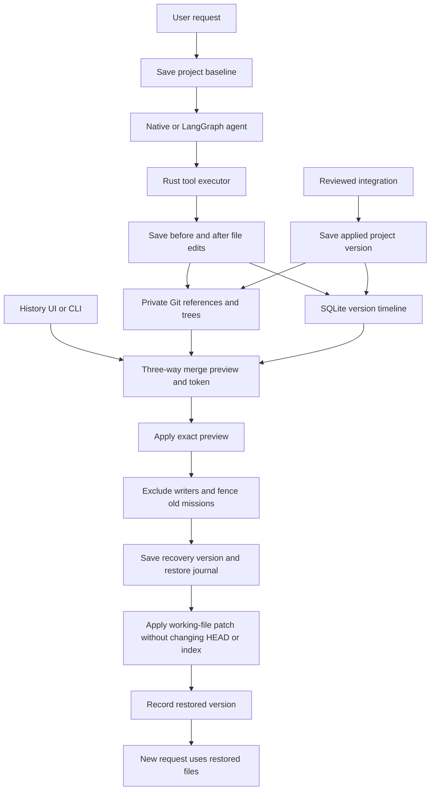

# History and restore

Maestro saves code versions alongside its conversation and task history. This
feature starts recording with this build; it does not reconstruct earlier tool
edits. Version storage requires a Git repository with an initial commit.

## Terminal UI

- `/history` opens the version timeline. Arrow keys select a version; Enter
  opens its full description and diff. Long descriptions and diffs wrap and
  scroll with arrows, Page Up/Down, or the mouse wheel.
- Press `r` on a version to preview restoring it. Enter on a conflict-free
  preview applies that exact preview. Escape closes without applying it.
- `/undo` previews undoing the latest saved request. Repeating it after applying
  an undo selects the previous request.
- `/restore <version>` opens a restore preview directly. IDs accept an
  unambiguous prefix of at least six characters.
- `/history save <label>` saves the current project explicitly.
- `/history diff <version>` displays the changes recorded by a version.

You can also ask naturally: **“Save this as a backup named Before redesign.”**
The conversational model calls `save_version {"label":"Before redesign"}` and
returns the saved version ID and restore command. It creates a real code
checkpoint rather than a backup file in your source tree.

For **“Save a backup, then redesign the homepage,”** the planner keeps both
requirements in the task. Working agents have the same `save_version` tool in
both native and LangGraph execution. They save their current task workspace;
these entries are marked `backup` and do not move the project baseline when
the workspace is isolated. A backup-before-edit request is carried into the
task instructions and acceptance criteria. During an active mission, chat
continues to deliver the request as steering for the agents' next turns.

The model must wait for a successful tool receipt before claiming a version
was saved. This tool saves local repository code; it does not back up external
databases or services. It cannot restore files or choose an arbitrary folder.

`before` entries are project snapshots at the start of a request. `draft`
entries are agent edits saved in isolated task worktrees; they may be unfinished
or unreviewed. `applied` entries record integration into the project. `manual`,
`recovery`, and `restored` entries identify explicit saves and restores. The
project baseline marker identifies the last saved/applied project version;
additional manual edits may exist in the working folder.

To recover a later state after an undo, select that later version or the
automatically saved recovery version and preview restoring it. This release
does not add a separate redo command or per-file restoration.

## CLI

```sh
maestro history
maestro history --save "Before experimenting"
maestro history --diff <version>
maestro undo
maestro restore <version>
```

The last two commands print a diff, affected missions, and an apply token.
Apply the reviewed result with:

```sh
maestro undo --apply <preview-token>
maestro restore <version> --apply <preview-token>
```

`--json` returns structured results for all commands. Applying always goes
through the daemon. A stale token is rejected if the project, staging, HEAD,
version timeline, or mission states changed after the preview.

## File and execution behavior

Restore merges the requested version with later working-file changes using
Git's three-way merge. Non-conflicting manual edits survive, including edits
elsewhere in the same file. Overlapping edits produce a conflict preview and
leave working files unchanged. New/deleted files, binary files, executable
modes, and symlinks are represented by Git trees. Ignored local-file collisions
are refused before applying.

Restore changes working files without moving HEAD or changing the user's
staging area. It does not rewrite commits or push anything. The resulting
changes remain available for normal inspection and committing. Private dotenv
paths, `.maestro`, and `node_modules` are excluded from restoration; ignored
files are not newly captured. Original tracked content already in Git remains
part of its existing commit history.

Before applying, Maestro saves a recovery version. A write barrier prevents
repository tools and finalization from overlapping the operation. All existing
missions are fenced from future execution; unfinished ones are cancelled.
Pending approvals are rejected and task leases are revoked. Existing reports,
reviews and LangGraph checkpoints remain historical evidence, but cannot
authorize work on the restored files. Submit a **new request** to continue;
it gets a fresh plan, context and execution checkpoint. Chat is not erased.

Undoing an unfinished request whose drafts have never reached the project
usually changes no project files; it retires that request. Its draft versions
remain available in history.

The restore journal covers interruption between applying the patch and writing
its completion receipt. On the next history/working operation, an exact before
or after tree is reconciled automatically. If the files match neither tree,
Maestro preserves them and reports the recovery version for inspection. It
does not guess which partial or external edits to discard. Filesystem changes
and SQLite writes are not one atomic transaction.

Versioning covers repository files. It does not reverse running services,
database writes, package installations, deployments, or other external effects.
Versions have no automatic expiry in this release; Git references retain them
after task worktree cleanup and Git garbage collection.

## Architecture



API endpoints: `GET/POST /api/history`, `GET /api/history/{id}/diff`,
`GET/POST /api/history/{id}/restore`, and `GET/POST /api/history/undo`.
Restore POST bodies contain `{"token":"<preview-token>"}` and use the existing
daemon authentication. Saved Git references use `refs/maestro/versions/<id>`.

Tests cover manual and staged edit preservation, stale previews, merge
conflicts, successive undo, forward restore, binary/non-UTF8 content, Unicode
paths, symlinks, ignored-file collisions, garbage collection, crash recovery,
native tool capture, authenticated HTTP operations, in-flight planning
cancellation, and terminal diff wrapping/scrolling.

Managed local previews are stopped before applying a code restore. External servers and databases are not rolled back. Image attachments remain in `.maestro/media/` and are not source-code versions.
