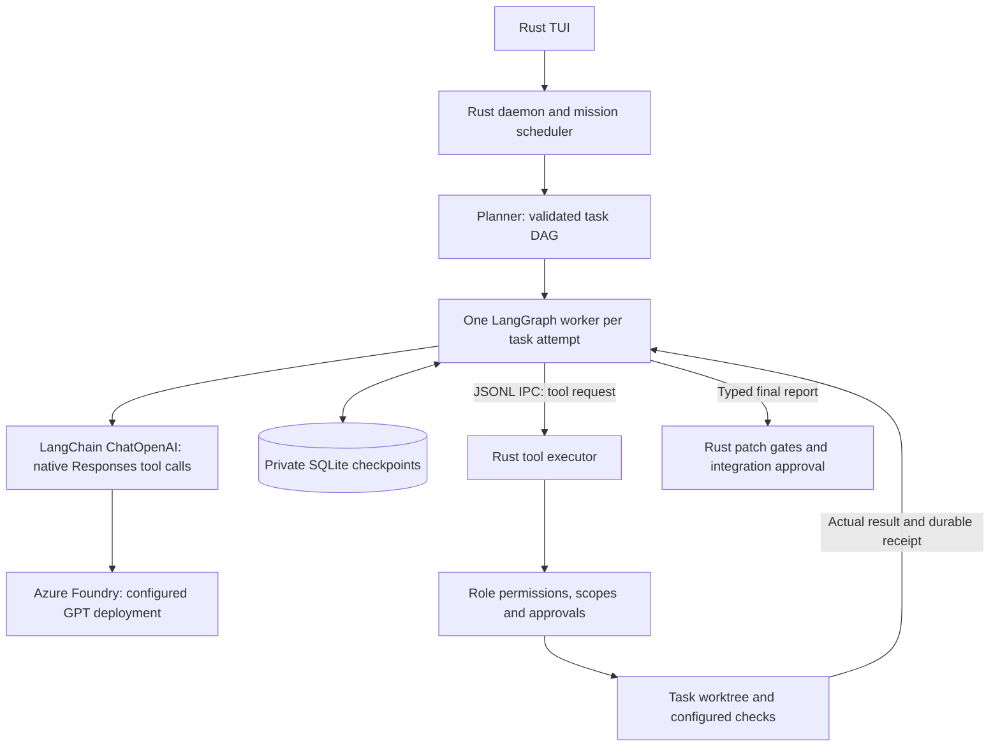

# LangChain and LangGraph execution

Maestro's working agents can now run through LangChain and LangGraph. Role model
assignments stay in `maestro.toml`. The planner chooses tasks and roles, never
models. Each role uses its configured primary and explicit failure fallbacks.
There is no complexity-based or model-selected routing.



## Ownership

- LangChain formats native model/tool messages, binds typed tool schemas, and
  returns tool-call IDs and parsed arguments. Models finish with the typed
  `submit_report` tool, rather than custom JSON embedded in prose.
- LangGraph owns the model/tool cycle, conversation state, bounded tool turns,
  a task-scope clarification for blocked reports, and SQLite checkpoints.
- Rust admits each API request through the existing deployment limiter and
  circuit breaker, checks mission budgets, and records actual returned usage.
- Rust executes every repository tool with the existing path/scope checks and
  approval policy. It still validates final reports and patch-bound verdicts.
- Planning, question routing, architect chat, the mission DAG, scheduling,
  worktrees, integration and the TUI remain Rust components. Planning and
  architect chat still use the native provider adapter in this first migration.

Checkpoint files live under `.maestro/agent-state/`, in a private directory.
API keys are inherited through the configured environment variable and are not
written to graph state or command-line arguments. LangSmith tracing is disabled.
The provider receives `store: false`; encrypted reasoning continuity is requested
for stateless Responses conversations. Full graph history is retained locally;
only the context submitted to a model is trimmed. A bounded receipt ledger
preserves inspected paths, tool outcomes and repeat counts when older file
bodies leave context. Oversized tool results retain marked head/tail excerpts,
while complete originals remain in checkpoints. This prevents rediscovery loops
caused by forgetting earlier reads; it does not claim those reads prove a task
is complete.

A thread is tied to the task, retry sequence, fixed model configuration and
workspace base. Approval/restart recovery resumes its pending graph node. An
explicit task retry starts a new thread. Rust journals native tool-call IDs:
completed calls return saved results on replay. An interrupted edit without a
completion receipt stops for workspace inspection instead of blindly repeating
it. This is conservative crash recovery, not a claim of transactional filesystem
edits. Per-request usage can remain unknown if a worker dies before its receipt.

## Installation

```sh
python scripts/install-langgraph.py --configure
cargo build --locked --release -p maestro-cli
```

The installer creates `~/.local/share/maestro/langgraph-venv`, installs exact
versions from `workers/langgraph/requirements.lock`, installs the worker, and
writes `agentRuntime = "langgraph"` plus an absolute `langgraphCommand` array in
the existing user config. It preserves role models and fallbacks. Restart the
Maestro daemon after changing its runtime configuration. Project configs still
override the user config entirely.

`agentRuntime = "native"` retains the legacy Rust loop for compatibility. There
is no silent switch back to it if the configured LangGraph worker fails to start.
The first LangGraph adapter supports `openai_responses` providers.

This migration does not add unrestricted shell execution or a managed local
development server. `run_check` executes configured commands only; an empty
`checks` list cannot verify a build or start an application. Review and runtime
limitations must be reported rather than presented as successful validation.

## Current-project snapshots

Previously, a Designer read the user's working folder while Coder worktrees
started from committed HEAD. That omitted uncommitted routes and components.

Before implementation starts, Maestro now builds a private snapshot using a
separate Git index and a private commit. It includes current tracked files and
untracked application files. Ignored files, runtime state, node_modules, and local
dotenv values are excluded; dotenv example/sample/template files are retained.
It does not change the user's HEAD or staging area. Read-only inspection uses a
source worktree, coding uses a separate worktree based on the same snapshot, and
review follows the coding workspace. Installed Next.js guides can be read from
the main checkout when absent from these worktrees.

A baseline is not replaced under integrated patches or partial coder edits.
Final integration still requires its normal approval and clean-tree/HEAD checks;
this change does not automatically commit or overwrite the user's original work.

## Validation

- Five graph tests cover native-tool dispatch, checkpoint recovery after an
  approval interruption, bounded block clarification, rejection of unknown
  tools, retained inspection receipts and oversized-result compaction.
- A Rust IPC integration test checks that Designer and Coder see an uncommitted
  application, an out-of-worktree write is denied, a replayed edit executes once,
  and reviewed changes reach final approval while the original file is preserved.
- Snapshot tests preserve differing staged/working versions and exclude runtime
  state and local dotenv data.
- A real GPT mission completed design, coding, independent review/security,
  checks and integration. Its 13 application tests passed. Azure 429s exercised
  the configured failure fallback without dynamic model selection.
- The existing Family-Tree mission was retried against its private current-tree
  snapshot. The coder could inspect and edit the previously missing application.
  After the context fix it advanced to review instead of repeating discovery.
  Review requested UI corrections, and the launch task reported that no startup
  command was configured. That mission remains blocked; its partial patch was
  not integrated, and the original working files and staging were verified
  unchanged. This is recovery evidence, not a successful application launch.

References: [LangChain OpenAI integration](https://docs.langchain.com/oss/python/integrations/chat/openai),
[LangGraph workflows](https://docs.langchain.com/oss/python/langgraph/workflows-agents),
[LangGraph persistence](https://docs.langchain.com/oss/python/langgraph/persistence),
[OpenAI function calling](https://developers.openai.com/api/docs/guides/function-calling).

## Review retries after new evidence

Checkpoint identity includes each direct dependency’s completion revision and patch identity. A reopened Shadow task therefore executes again after Sentinel produces new verification, even when the code patch is unchanged. Explicit retries also start a fresh thread; ordinary lease/approval recovery with unchanged dependencies retains the existing checkpoint and tool receipts.
