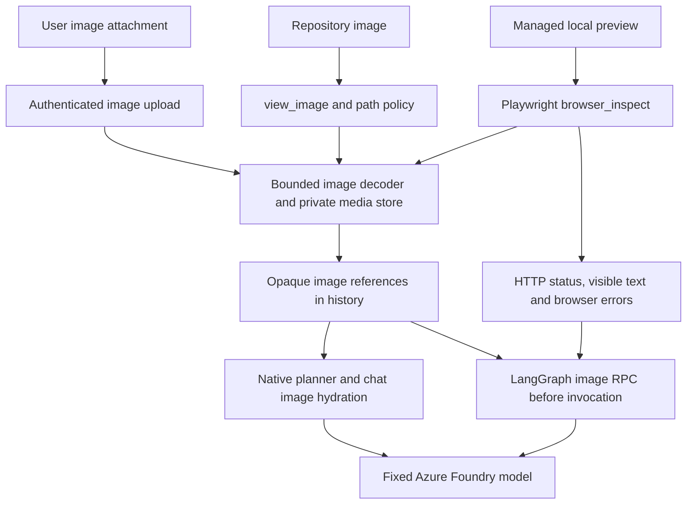

# Images, browser inspection and local previews

Maestro sends image pixels to the configured models through Azure Foundry. Role assignments remain fixed: Shogun (planning) and Shadow Council (review/security) use Astra; Samurai (implementation) and Sentinel (testing/verification) use GPT 6.1 Sol. New guild missions have no separate Designer. Neither image analysis nor tool execution uses another coding CLI.

## Using images

In the TUI:

```text
/attach ~/Pictures/reference.png
Explain this layout, then use it as the reference for the redesign.
```

Attach up to four PNG, JPEG or WebP images before sending your message. `/attach clear` removes pending attachments. Attachments also work with `/ask`, `/run` and `/steer`. Upload finishes with an “Attached…” message; wait for that before sending the prompt. Failed chat requests retain pending attachments for retry.

Agents can call `view_image {"path":"public/reference.png"}` to inspect a repository image. The model receives pixels, not just the filename or a text description. Paths must remain within the workspace and pass read policy, including symlink resolution.

Images are limited to 12 MiB on upload, decoded with allocation/dimension limits, reduced to at most 1536 pixels on either side, and normalized to JPEG. The private `.maestro/media/` store retains them across sessions. Transcripts and LangGraph checkpoints contain opaque references; image data is loaded only when constructing model input. The latest four referenced images are supplied in a working-agent invocation. This is suitable for UI screenshots and visual references; very small text may need a cropped image.

## Inspecting a running app

Ask Maestro to start the app locally and check its appearance. Working agents have:

| Tool | Purpose |
| --- | --- |
| `preview_start {"port":null}` | Start a Next.js or Vite `dev` script in the current task workspace, bound to loopback on an available port. |
| `preview_status {}` | Inspect process status, URL and recent logs. |
| `browser_inspect {"url":"http://127.0.0.1:3000","width":1280,"height":800}` | Return screenshot pixels, visible page text, HTTP status, console errors and page errors. |
| `preview_stop {}` | Stop that workspace's managed preview and child processes. |
| `run_project_task {"name":"lint"}` | Run an existing `lint`, `build`, `test` or `typecheck` npm script through the existing check sandbox. |

Use `/preview` to see all managed preview URLs and logs for the project. `/preview stop` stops them. A running preview retains its task workspace after mission completion; shutdown or applying a code restore stops managed previews. Existing unrelated servers are not stopped. The supplied URL can show the task's changes before final integration approval.

Process startup is not proof that an app works: the agent must check the HTTP response and browser evidence. Preview processes receive the local application's dotenv configuration, but do not inherit Maestro provider credentials. Known dotenv values are redacted from logs. Required previews execute inside Bubblewrap with a private writable home, read-only dependencies and networking enabled for the dev server. Ordinary project checks retain their configured network restrictions. Use the exact URL returned by `preview_start`; do not guess port 3000. Dependencies must already be installed.

Browser inspection uses a fresh Chromium context, supports localhost URLs only, and permits same-origin GET/HEAD/OPTIONS requests. It blocks external resources, mutating requests, service workers, and unrelated WebSockets. The same-origin Next.js HMR channel is allowed for client hydration; only chunk subscription messages are forwarded from the browser, not console logs or arbitrary application commands. Blocked requests are reported. It does not click controls, log in, submit forms, or test workflows that need those requests. External fonts or assets can therefore affect the captured appearance. Inspect another viewport by calling the tool again with a different width/height.

## Reading and reviewing code

`read_file` accepts optional `startLine` (1-based) and `maxLines` (up to 1000). Results include `totalLines`, `truncated` and `nextLine`, so an agent can continue reading a long file rather than repeatedly reading its beginning. The default window is 300 lines, still subject to the character limit.

`git_diff {"path":"src/app/page.tsx"}` shows changes to one readable file against the task starting revision (HEAD in chat), including an untracked file. The result includes all changed paths. It rejects directories and protected paths. These tools complement `save_version`, `/history`, `/undo` and `/restore`; they do not replace version history.

## Installation and data flow

Run `python scripts/install-langgraph.py`, then `python scripts/install-browser.py`, and build/install the Maestro binary. The browser installer installs pinned Playwright into the existing worker virtual environment, using system Chromium when available. `MAESTRO_BROWSER_PYTHON` can point to another Python environment with Playwright installed.



## Validation

The implementation is covered by image normalization/path tests, file-range and tool-policy tests, transport payload checks and a LangGraph checkpoint test. A live Foundry chat identified a blue rectangle on the left and an orange circle on the right from an uploaded image. A separate live LangGraph mission used `view_image` in both coder and reviewer tasks and completed the reviewed description. A real Next.js 16 Turbopack preview with a client hydration marker was started inside required sandbox mode, captured in Chromium with HTTP 200 and no page errors, and stopped through the tool. Repeated invocations reuse read-only dependencies without mistaking empty mountpoints for an installation.
