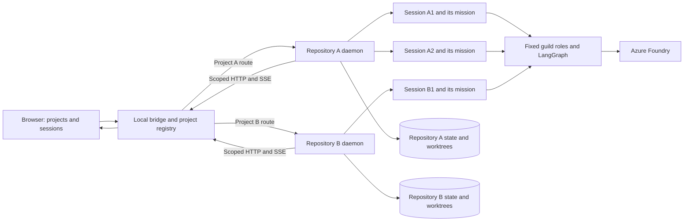

# Live guild integration and presentation checklist

The default website is now a real client of the Rust Maestro daemon. The original pixel world is retained; the previous scripted mission player is not loaded by the application entry point.



## Projects, sessions and background work

The local T3 database was inspected read-only as a reference: `projection_projects` owns a `workspace_root`, and `projection_threads` belongs to a `project_id` with its own run/session state. Maestro now presents the same project → session hierarchy without importing or changing T3 conversations.

- **Open project** browses local folders or accepts an absolute path. The folder picker can create a new Git project with an initial empty commit. Existing directories are not initialized or modified by the picker.
- The **＋** beside a project opens another persistent session in that repository. Sessions have independent conversations, missions, drafts, attachments and in-flight requests.
- Switching the visible session does not cancel work. Each session owns an immutable project-scoped HTTP client; replies cannot land in the currently visible but unrelated session. Background status is shown in the project sidebar.
- Requests, images and event streams use `/p/<project-id>/api/...`. The bridge resolves the registered canonical folder and its own daemon descriptor, and keeps daemon credentials server-side. There is no mutable server-wide selected repository.
- Registered folders persist in `~/.local/share/maestro/web-projects.json`; `MAESTRO_PROJECTS_FILE` overrides that location. Selected session, drafts and placeholder-title aliases persist in browser storage, keyed by both project and session. Closing the browser or bridge does not stop repository mission workers.

The old empty mission strip and global mission dropdown are removed. A session with a mission shows that run’s actual state and controls; an ordinary conversation shows no idle mission banner. The footer is a compact floating input, expanding on focus with attachment/mode controls and collapsing with the down arrow or Escape. Appearance controls are grouped in a menu.

## Four agents, distinct contracts

| PS-001 agent | Responsibility | Fixed model | Compatible daemon key |
| --- | --- | --- | --- |
| Shogun | Requirements, reconnaissance, design decisions and task planning | GPT 6 Astra | planner |
| Samurai | Scoped implementation and responding to verification findings | GPT 6.1 Sol | coder |
| Sentinel | Independent tests/build/lint and acceptance verification | GPT 6.1 Sol | reviewer |
| Shadow Council | Correctness, readability, regressions and security review | GPT 6 Astra | security |

The daemon's guild mode requires both a Sentinel and Shadow dependency for each Samurai code task, with fresh verdicts bound to the patch being integrated. A separate Designer is not scheduled in new guild plans. Old stored role keys and historical tasks remain readable. The Living Campaign is the scheduler/shared state and feedback flow, not another decorative agent.

## TUI feature comparison

| Capability | Website implementation |
| --- | --- |
| Natural-language chat and implementation requests | Persistent composer with chat/auto, new-mission and steering modes |
| Session history | Project sidebar with persistent sessions, per-session drafts and background status |
| Mission selection and status | Select the owning session; its actual mission status and controls appear only when present |
| Team/model roster | Four named guild agents, fixed models and real task states |
| Full task descriptions | Tasks page with dependencies, acceptance criteria, summaries and blocked reasons |
| Plan approval | Inspect plan, approve or reject a pending plan |
| Pause/resume/cancel/retry | Mission controls and per-task retry |
| Live tool activity | Replaying SSE stream, expandable receipts and execution record |
| Review and integration approval | Actual diff in a decision dialog; server-side approval remains authoritative |
| Save backup, undo, restore | History page, named versions, diffs, exact preview-token restore confirmation |
| Images | File picker, clipboard image paste, drag/drop, persisted attachment display and multimodal chat |
| Local app previews | URL/log display and stop control; agents start the project through tools |
| Readable output | Safe Markdown, expandable evidence, scroll preservation, persistent draft composer |
| Display controls | Dark/light theme, scenery pause, reduced motion, camera navigation, laptop/mobile layout |
| Model/credential editing | Remains in local Maestro configuration/TUI; the requested fixed assignments are preserved |

The website does not yet add a remote/cloud relay, multi-user accounts, inline code editing, terminal emulation, or browser form automation. It supports multiple local repositories and sessions through one daemon per repository. Raw output streams are tool/turn events; this is not token-by-token model streaming. The current view retains the latest 500 mission events, and chat uses the daemon's bounded history endpoint. Exported evidence describes the loaded execution record, not an unlimited database export.

## Run for the mentor round

The Rust backend and LangGraph/browser workers are included under `backend/`. Follow [the combined setup guide](SETUP.md), including provider configuration and `guildRoles = true`. Then, from the repository root:

```sh
npm ci
MAESTRO_PROJECT=/absolute/path/to/your/project npm run dev
```

Open `http://127.0.0.1:5173`. Use `MAESTRO_PORT=5174` if necessary. The bridge starts the selected project's daemon if needed. `MAESTRO_PROJECT` chooses the initial folder; use **Open project** and the sidebar to add/switch folders without restarting. The Connection page describes the selected session’s repository. A public static deployment alone cannot access a viewer's local daemon.

Suggested walkthrough:

1. Show the four guild roles and fixed model assignments.
2. Submit a small concrete request; open Tasks to explain dependencies and acceptance criteria.
3. Show real tool receipts, checks and independent verdicts in Evidence.
4. Inspect the actual patch and approve only the result you intend to apply.
5. Open the local preview URL, or demonstrate an image reference.
6. Save a named version and demonstrate a previewed undo on a disposable demo repository.

Avoid using an unrelated service on port 3000 as evidence. `preview_start` automatically chooses a free port when none is specified; inspect the exact returned URL. The daemon now supplies npm a private home directory and exposes installed dependencies read-only to task sandboxes. Required sandbox mode remains enforced for previews.

## What remains for a complete PS-001 submission

A working UI and an end-to-end approved mission do not alone prove every evaluation scenario. The submission still needs a curated evidence package for a seeded bug, a test-driven repair, a planted security issue, and unexpected-tool/ambiguous-request handling. Generic evidence-driven repair/re-review and stronger acceptance-to-check enforcement remain engine work unless demonstrated by a specific run. Do not describe old scripted sample results as live agent evidence.

## Current recovered application run

The Family-Tree theme mission passed Sentinel and Shadow Council and is awaiting final human approval. The retained preview is `http://127.0.0.1:33899`; preview ports are ephemeral. Existing React lint errors and network-restricted font fetching remain recorded limitations, not successful checks. The additional dependency-checkpoint retry fix is installed in the latest binary; the current daemon is retained to keep this preview running and loads that fix on its next restart.
